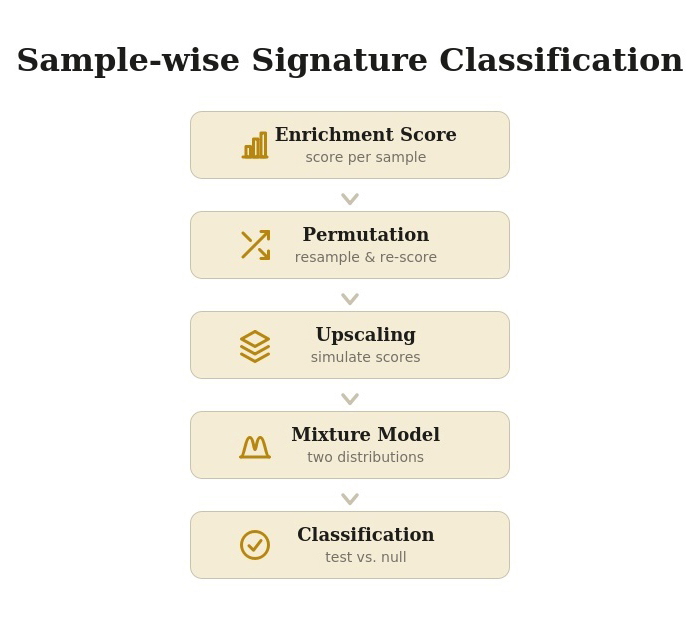
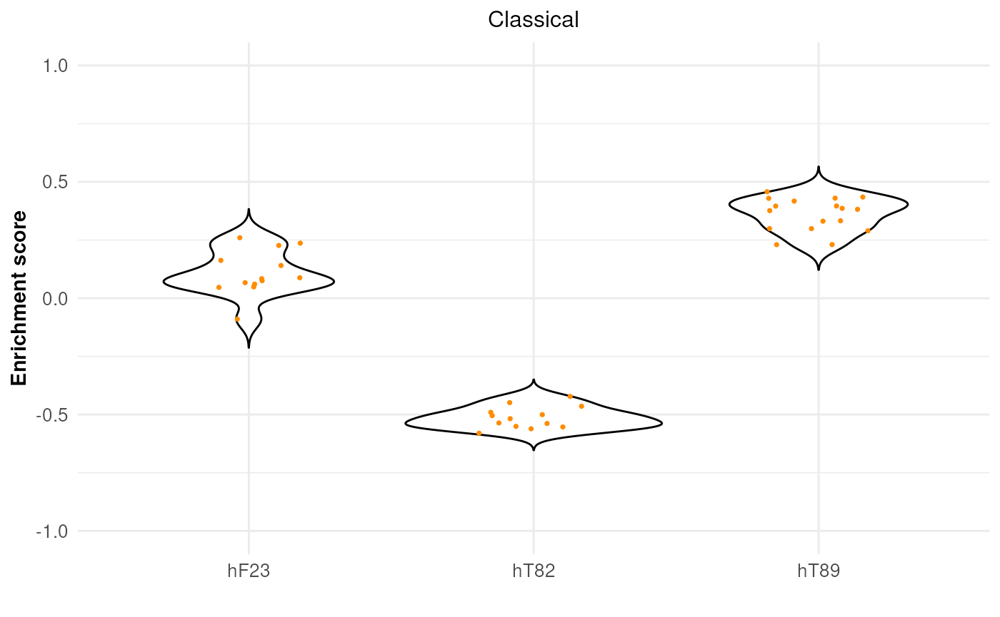
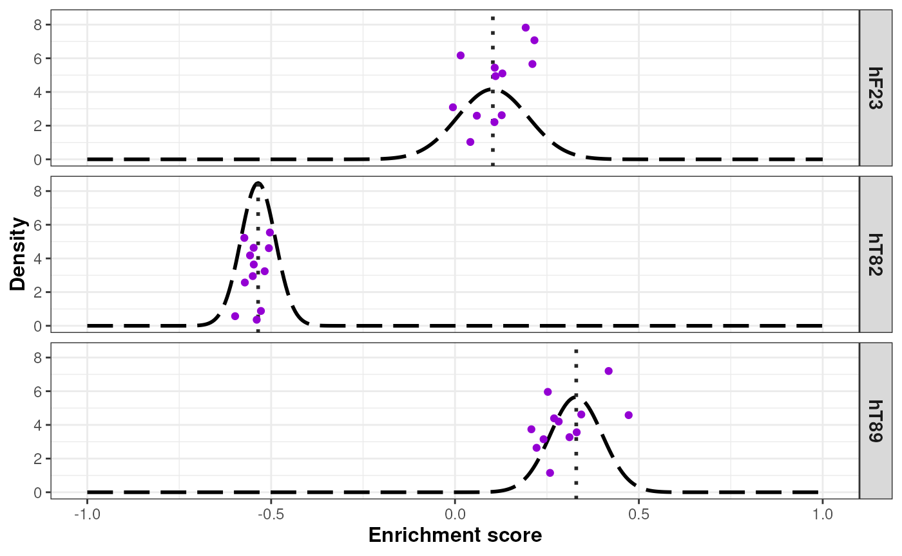
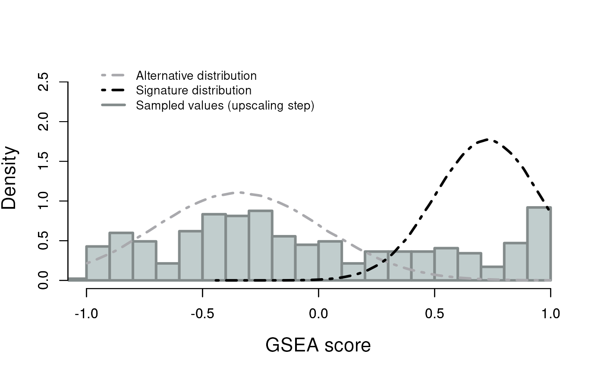
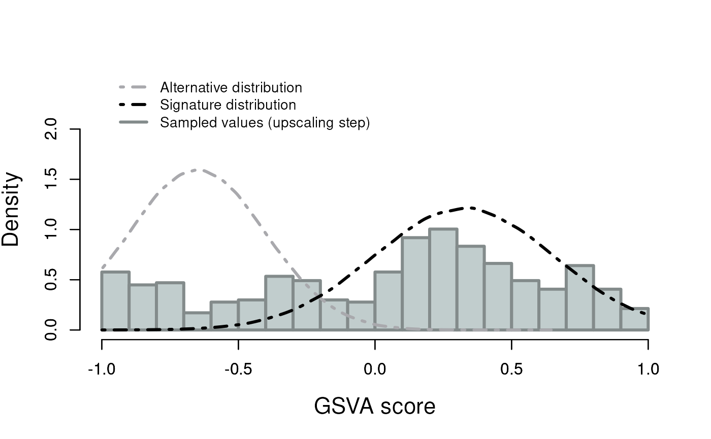
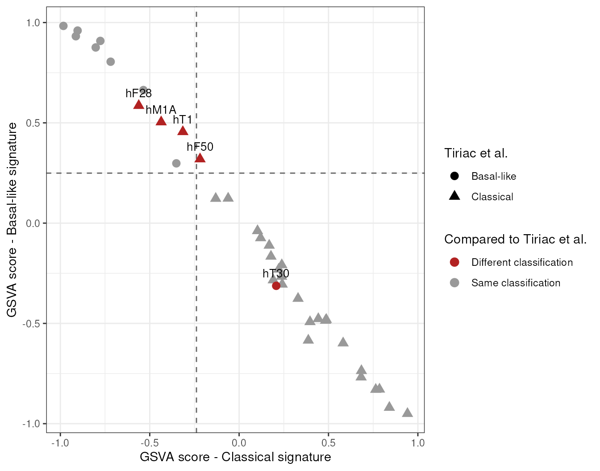

# Transcriptomic Classification using Mixture of Normal Distributions

\

**Package**: *splitTypeR*\
**Authors**: Astrid Deschênes \[aut, cre\] (ORCID:
<https://orcid.org/0000-0001-7846-6749>), Pascal Belleau \[aut\] (ORCID:
<https://orcid.org/0000-0002-0802-1071>), David A. Tuveson \[aut\]
(ORCID: <https://orcid.org/0000-0002-8017-2712>), Lustgarten Foundation
\[fnd\]\
**Version**: 0.99.9\
**Compiled date**: 2026-11-05\
**License**: Artistic-2.0\

## Licensing and citing

This package and the underlying ***splitTypeR*** code are distributed
under the Artistic license 2.0. You are free to use and redistribute
this software.

If you use this package for a publication, we would ask you to cite the
following:

``` r

## Citation information for the splitTypeR package
citation("splitTypeR")
```

    ## To cite package 'splitTypeR' in publications use:
    ## 
    ##   Deschênes A, Belleau P, Tuveson DA (2026). _splitTypeR:
    ##   Transcriptomic Classification using Mixture of Normal Distributions_.
    ##   R package version 0.99.9, <https://github.com/adeschen/splitTypeR>.
    ## 
    ## A BibTeX entry for LaTeX users is
    ## 
    ##   @Manual{,
    ##     title = {splitTypeR: Transcriptomic Classification using Mixture of Normal Distributions},
    ##     author = {Astrid Deschênes and Pascal Belleau and David A. Tuveson},
    ##     year = {2026},
    ##     note = {R package version 0.99.9},
    ##     url = {https://github.com/adeschen/splitTypeR},
    ##   }

\

## Introduction

Cancer classification, using RNA sequencing, is now part of modern
precision oncology. For some cancers, RNA classification provides deep
insights into tumor aggressiveness and growth rates. For example, breast
cancer subtypes (like Luminal-A, Luminal-B, HER2-enriched, or
Basal-like) help forecast patient outcomes (Cascianelli et al. 2020).
The Luminal-A is the most common molecular subtype of breast cancer,
making up to 60% of all breast cancer cases. It is also associated with
good prognosis, while Luminal-B tumors have a more aggressive phenotype
and a worse prognosis (Yersal 2014). Once widely accepted by major
oncology organizations, gene signatures for RNA subtyping are used to
classify cancer subtypes, predict patient survival, and guide treatment.

From a research perspective, the classification of new samples using
their transcriptional profiles can be done using different tools. For
some cancers, machine learning models and dedicated software are
available such as the Bioconductor Genefu package for breast cancer
molecular subtyping (Gendoo et al. 2016), and the CMScaller package for
subtyping of colorectal cancer (Eide et al. 2017).

In the absence of dedicated software, unsupervised clustering with a
heatmap visualization to classify transcriptomic samples with a gene
signature is often employed. This method is relatively simple and offers
instant visual support. However, this method has a few drawbacks:

- *Lack of statistical metrics*: It doesn’t provide a statistical
  probability score for a sample’s class assignment; it mainly acts as a
  visual summary.
- *Metric sensitivity*: Changing the clustering metric (e.g., from
  “Euclidean” to “Pearson” distance) can alter the resulting clusters.
- *Outlier distortion*: Extreme outliers can squash the color scale, and
  artificially create skewed subsets.

The ***splitTypeR*** package resolves these issues by providing an
automated statistical framework to classify heterogeneous biological
samples based on gene signature lists, effectively isolating the
signature-positive samples.

This classification method is designed for bulk transcriptomic datasets.

\

## Installation

As with any R package, the ***splitTypeR*** package should first be
loaded with the following command:

``` r

library(splitTypeR)
```

\

## Quick start

The ***splitTypeR*** package includes a small demonstration dataset: two
gene signatures (`signaturesDemo`) and a matrix of normalized expected
counts for 30 patients (`expNormalCountsDemo`). The whole subtyping
method can be run on it in a few lines:

``` r

## Load the demo signatures and the demo normalized expected counts
data(signaturesDemo)
data(expNormalCountsDemo)

## Fix seed for reproducible results
set.seed(121)

## Run the subtyping method
## The normalized expected counts used as input are log2-transformed 
quickResult <- runSubtypingBimodal(geneLists=signaturesDemo,
    expectedCountsMatrixLog=log2(expNormalCountsDemo + 1),
    permRatio=0.75, permNbr=20, upscaleNbr=10)

## Display a summary of the results
quickResult
```

    ## A SplitTypeRdata object
    ## Signatures (2): Classical (62 genes), Basal-like (26 genes)
    ## Samples: 30
    ## Completed steps: gsvaResults, permutations, standardDeviation, upscaling, model, threshold, classification
    ## Classification:
    ##   Classical: 14 assigned, 16 unclassified
    ##   Basal-like: 15 assigned, 15 unclassified
    ## Use classification() to get the classification of each sample.

Each step of the method is detailed in the next section, followed by a
complete demonstration on a published dataset.

\

## Method

The following figure represents the statistical method employed to turn
a noisy, single-number enrichment score into a confident binary
classification of each sample. In summary, the method estimates the
uncertainty around each enrichment score, models the cohort as a mixture
of two biological states, and then statistically tests each sample
against that mixture.



General workflow.

\

The statistical method is split into 5 steps. Each of those steps is
performed for one specific signature at a time. A signature is typically
a predefined set of features (transcriptomic expression in this
situation) that is associated with some biological state, pathway, or
phenotype.

### Step 1. Enrichment score

The enrichment scores are first computed for every single sample with
the Bioconductor *[GSVA](https://bioconductor.org/packages/3.24/GSVA)*
package (Hänzelmann et al. 2013). Those scores represent the real score
for each sample. Later steps treat this real score as the anchor point
around which uncertainty gets modeled.

### Step 2. Permutation

Random subsets of samples, of fixed size, from the full dataset are
repeatedly drawn. For each of these resampled subsets, the enrichment
score for the samples present is recomputed.

This step enables a per-sample uncertainty estimation (standard
deviation).

### Step 3. Upscaling

For each sample, a fixed number of simulated enrichment scores are drawn
from a normal distribution centered on the real score, using the
standard deviation estimated from permutations.

This step enables the upscaling of the total number of values that will
be used in the next step.

### Step 4. Mixture model

The synthetic values across all samples are pooled to fit two
overlapping normal distributions to them. The two normal distributions
are extracted using a mixture model approach implemented in the
*[mixtools](https://CRAN.R-project.org/package=mixtools)* package
(Benaglia et al. 2009). The assumption is that the whole cohort is a
blend of two underlying populations (a “low-mean” population and a
“high-mean” population).

### Step 5. Classification

Each sample is classified with a one-sided hypothesis test based on the
“low-mean” distribution of the mixture model (from Step 4):

- **Null hypothesis (H₀)**: the sample belongs to the “low-mean”
  distribution
- **Alternative hypothesis (H₁)**: the sample belongs to the “high-mean”
  distribution

The 95th percentile of the “low-mean” distribution is used as the
classification threshold. Each sample’s real enrichment score (from
Step 1) is compared to this threshold. A score above the threshold has
less than a 5% probability of being produced by the “low-mean”
distribution (one-sided p-value \< 0.05). In that case, H₀ is rejected.


Classification of the samples (schematic). The curve represents the
“low-mean” distribution of the mixture model. The dashed line is the
classification threshold (95th percentile) and the shaded area
represents the upper 5% of the distribution. Sample A, with a score
below the threshold, remains unclassified while sample B, with a score
above the threshold, is assigned to the signature.

When H₀ is rejected (p-value \< 0.05), the sample is assigned to the
tested signature. Otherwise, the sample is labeled as “unclassified” for
that signature.

Since each signature is tested independently, a sample can be assigned
to one signature, to several signatures, or to none of them.

\

## Available signatures

The ***splitTypeR*** package provides transcriptomic signatures.

The *getGeneSignaturesNames()* function lists the names of all the
available signatures.

``` r

## List the names of the available signatures
getGeneSignaturesNames()
```

    ## [1] "Tiriac_PDAC_PDO_Basal_like" "Tiriac_PDAC_PDO_Classical" 
    ## [3] "Moffitt_Basal_like"         "Moffitt_Classical"         
    ## [5] "Miyabayashi_Fast"           "Miyabayashi_Slow"

\

The *getGenesInSignature()* function returns the genes of one signature,
while the *getGeneSignatures()* function returns a named list containing
one or more signatures. When no name is given, *getGeneSignatures()*
returns all the available signatures.

``` r

## Get the genes of the basal-like signature
getGenesInSignature(name="Tiriac_PDAC_PDO_Basal_like")
```

    ##  [1] "ANO1"     "ADORA2B"  "S100A2"   "CSF2"     "ANXA1"    "EREG"    
    ##  [7] "RGS20"    "CELSR1"   "WNT7B"    "AMIGO2"   "PTHLH"    "C12orf54"
    ## [13] "TGM2"     "REEP3"    "DCBLD2"   "NMB"      "IKZF2"    "GPR87"   
    ## [19] "MUC16"    "IVL"      "SPRR1B"   "BCAR3"    "TTC9"     "PTGES"   
    ## [25] "CST6"     "CATSPER1"

``` r

## Get all the available signatures and count the genes in each one
allSignatures <- getGeneSignatures()
lengths(allSignatures)
```

    ## Tiriac_PDAC_PDO_Basal_like  Tiriac_PDAC_PDO_Classical 
    ##                         26                         62 
    ##         Moffitt_Basal_like          Moffitt_Classical 
    ##                         25                         25 
    ##           Miyabayashi_Fast           Miyabayashi_Slow 
    ##                        231                        333

\

The current signatures are:

- **Tiriac_PDAC_PDO_Basal_like**: the basal-like signature (26 genes)
  defined for pancreatic ductal adenocarcinoma (PDAC) patient-derived
  organoids (PDOs) in Tiriac et al. (Tiriac et al. 2018).
- **Tiriac_PDAC_PDO_Classical**: the classical signature (62 genes)
  defined for PDAC PDOs in Tiriac et al. (Tiriac et al. 2018).
- **Moffitt_Basal_like**: the original basal-like signature (25 genes)
  defined for PDAC in Moffitt et al. (Moffitt et al. 2015).
- **Moffitt_Classical**: the original classical signature (25 genes)
  defined for PDAC in Moffitt et al. (Moffitt et al. 2015).
- **Miyabayashi_Fast**: the fast signature (231 genes), updated from the
  Ensembl IDs (GENCODE v48/org.Hs.eg.db), defined for PDAC xenografts in
  Miyabayashi et al. (Miyabayashi et al. 2020).
- **Miyabayashi_Slow**: the slow signature (333 genes), updated from the
  Ensembl IDs (GENCODE v48/org.Hs.eg.db), defined for PDAC xenografts in
  Miyabayashi et al. (Miyabayashi et al. 2020).

\

### Using your own signatures

The method is not limited to the signatures included in the
***splitTypeR*** package. Any named `list` of at least two gene vectors
can be passed to the *runSubtypingBimodal()* function. The names of the
list are used as the signature names in the results. The gene
identifiers must use the same format as the row names of the expression
matrix (e.g., gene names, Ensembl IDs). Genes absent from the expression
matrix are ignored. It is recommended to use signatures with 10 genes or
more to ensure statistical stability and reliability of the enrichment
scores.

``` r

## Example of custom signatures
mySignatures <- list(
    SignatureA=c("GENE1", "GENE2", "GENE3", "GENE4", "GENE5", "GENE6",
            "GENE7", "GENE8", "GENE9", "GENE10", "GENE11"),
    SignatureB=c("GENE4", "GENE9", "GENE10", "GENE12", "GENE13", "GENE15",
            "GENE16", "GENE17", "GENE18", "GENE19", "GENE20", "GENE21"))
```

\

## Demonstration

For this demonstration, we are going to use the published RNA-seq
dataset of pancreatic ductal adenocarcinoma (PDAC) patient-derived
organoids (PDOs) published in Tiriac et al. (Tiriac et al. 2018). The
RNA-seq has been aligned with GENCODE v48 on GRCh38.p14 genome with STAR
v2.7.9a (Dobin et al. 2013). Only one PDO per patient was retained. The
expected counts were processed with
*[DESeq2](https://bioconductor.org/packages/3.24/DESeq2)* v1.50.2 (Love
et al. 2014) on genes expressed in at least 20% of the PDOs. The
normalized expression is available in a *SummarizedExperiment* object.

In PDAC, the basal-like and classical subtypes, as defined in Moffitt et
al. (Moffitt et al. 2015), are the two consistently employed molecular
subtypes. The classical signature is associated with better prognosis
and better response to standard chemotherapy, while the basal-like
subtype is associated with worse overall prognosis (Moffitt et al. 2015;
O’Kane et al. 2020). These signatures were later redefined for
patient-derived organoids (Tiriac et al. 2018).

\

### Prepare the signatures

The basal-like and classical gene signatures used in the demonstration
are the ones defined for PDOs in Tiriac et al. (Tiriac et al. 2018).

``` r

## Required package
library(splitTypeR)

## Prepare the PDOs basal-like and classical signatures
signaturesList <- list()
signaturesList[["Basal-like"]] <- 
        getGenesInSignature("Tiriac_PDAC_PDO_Basal_like")
signaturesList[["Classical"]] <- 
        getGenesInSignature("Tiriac_PDAC_PDO_Classical")
```

\

### Prepare the log2-transformed normalized expected counts

A matrix of normalized expected counts is required. The rows are the
genes, while the patients (samples) are the columns.

The row annotation must correspond to the signature format. As an
example, if the signatures are composed of gene names, the row
annotation for the normalized expected counts must also be gene names.

For GSVA analysis, the normalized expected counts should be
log-transformed to enable the use of the Gaussian distribution function.
The current behavior of GSVA is to automatically choose one of the
available distribution functions.

``` r

## Required package
library(SummarizedExperiment)

## Load the SummarizedExperiment object
path <- system.file("extdata", "Tiriac_NormExpCounts.RDS", 
                        package="splitTypeR")
se <- readRDS(path)

## Extract the normalized counts and assign the gene names as row names
## The row names should correspond to the information present in the 
## gene signatures. In this case, the gene names are used. 
normCounts <- assays(se)[["normalizedCounts"]]
rownames(normCounts) <- rowRanges(se)$gene_name

## Log2-transform the data, adding a small pseudo-count to 
## prevent log2(0) errors 
log2normCounts <- log2(normCounts + 1)
```

\

### Run the subtyping method

The *runSubtypingBimodal* function runs all the steps. Three parameters
control the permutation and upscaling steps:

| Parameter | Description | Default | Trade-off |
|:---|:---|:--:|:---|
| `permRatio` | Proportion of the samples randomly selected in each permutation (Step 2). Must be between 0 and 1, and must not select all the samples. | 0.75 | A lower value creates more variation between permutations, but each GSVA score is computed on fewer samples. |
| `permNbr` | Number of permutations (Step 2). Must be 5 or higher. | 20 | More permutations give a more stable standard deviation for each sample, but take longer to run since GSVA is run once per permutation. |
| `upscaleNbr` | Number of values drawn from the normal distribution of each sample (Step 3). Must be 2 or higher. | 10 | More values give more data to fit the mixture model (Step 4), with little impact on the run time. |

\

Each sample is present, on average, in `permRatio` × `permNbr`
permutations (15 with the default values), which is the number of values
used to estimate its standard deviation.

\

``` r

## Fix seed for reproducible results
set.seed(81)

## Run the subtyping method using the log2-transformed data
result <- runSubtypingBimodal(geneLists=signaturesList, 
    expectedCountsMatrixLog=log2normCounts,
    permRatio=0.75,
    permNbr=20,
    upscaleNbr=12)

## Summary of the classification results
result
```

    ## A SplitTypeRdata object
    ## Signatures (2): Basal-like (26 genes), Classical (62 genes)
    ## Samples: 39
    ## Completed steps: gsvaResults, permutations, standardDeviation, upscaling, model, threshold, classification
    ## Classification:
    ##   Basal-like: 13 assigned, 26 unclassified
    ##   Classical: 27 assigned, 12 unclassified
    ## Use classification() to get the classification of each sample.

\

The resulting object contains information from each step of the process.
The information can be accessed using the appropriate getter function.

\

``` r

## Get the list of genes in the classical signature
signatures(result)[["Classical"]]
```

    ##  [1] "MUC13"      "GPR35"      "USH1C"      "BAIAP2L2"   "GAL3ST1"   
    ##  [6] "VIL1"       "DDC"        "LGALS4"     "TSPAN8"     "SLC5A1"    
    ## [11] "SEMA4G"     "TNFRSF11A"  "HSD17B2"    "CKMT1A"     "DPCR1"     
    ## [16] "GCNT3"      "SLC6A20"    "POF1B"      "NR1I2"      "MUC17"     
    ## [21] "HHLA2"      "BTNL8"      "HEPH"       "PDZD3"      "MYO1A"     
    ## [26] "CDH17"      "MYO7B"      "GPA33"      "CALML4"     "ANXA13"    
    ## [31] "TM4SF20"    "SI"         "SLC44A4"    "FAM83E"     "SLC40A1"   
    ## [36] "CTSE"       "BACE2"      "SULT1C2"    "AGR3"       "ATP7B"     
    ## [41] "LYZ"        "TESC"       "TOX3"       "SH3BGRL2"   "GMDS"      
    ## [46] "GATA6"      "GPX2"       "CA2"        "ST6GALNAC1" "FOXA3"     
    ## [51] "AKR1C3"     "TMC5"       "CYP2S1"     "PAQR8"      "HKDC1"     
    ## [56] "IYD"        "DOK4"       "CYP2C18"    "KCNE3"      "FZD5"      
    ## [61] "RASEF"      "GKN1"

\

``` r

## Get the GSVA scores for all samples in each signature
gsvaResults(result)
```

    ##                   hF2        hF23       hF24       hF27       hF28        hF3
    ## Basal-like  0.9318280 -0.03854167 -0.2301837  0.1225434  0.5857513  0.9833333
    ## Classical  -0.9134078  0.10297767  0.2214765 -0.1309421 -0.5614173 -0.9829707
    ##                  hF31       hF32       hF34       hF39       hF43       hF44
    ## Basal-like -0.4769812 -0.3051282 -0.5843797 -0.4853994 -0.2838235 -0.7680835
    ## Classical   0.4431077  0.2409733  0.3870926  0.4834900  0.1909814  0.6826443
    ##                  hF50       hF57      hM17D      hM19A       hM1A        hM8
    ## Basal-like  0.3194667 -0.8285276 -0.1657321  0.8758845  0.5039683  0.9084949
    ## Classical  -0.2185772  0.7852966  0.1781993 -0.8022948 -0.4360974 -0.7763975
    ##                   hT1      hT101      hT102      hT105      hT108      hT123
    ## Basal-like  0.4552901 -0.0738573 -0.7361761  0.2980769 -0.1111111 -0.2083333
    ## Classical  -0.3147877  0.1204267  0.6841604 -0.3511774  0.1682968  0.2387448
    ##                 hT125     hT127       hT25        hT3       hT30        hT48
    ## Basal-like  0.3246225  0.804817 -0.4921797 -0.8297218 -0.3125731  0.12342611
    ## Classical  -0.2855204 -0.718669  0.3966346  0.7642829  0.2075656 -0.06132129
    ##                  hT60       hT81       hT82      hT85       hT89       hT91
    ## Basal-like  0.9600173 -0.4809993  0.6633929 -0.950000 -0.3759857 -0.9194444
    ## Classical  -0.9035783  0.4877874 -0.5354225  0.941871  0.3297384  0.8405669
    ##                  hT93       hT96       hT98
    ## Basal-like -0.5982201 -0.3102627 -0.2657718
    ## Classical   0.5818909  0.3609801  0.2376757
    ## attr(,"gsvaParam")
    ## attr(,"gsvaParam")$originalClassWasSE
    ## [1] FALSE
    ## 
    ## attr(,"gsvaParam")$geneSets
    ## attr(,"gsvaParam")$geneSets$`Basal-like`
    ##  [1] "ANO1"     "ADORA2B"  "S100A2"   "CSF2"     "ANXA1"    "EREG"    
    ##  [7] "RGS20"    "CELSR1"   "WNT7B"    "AMIGO2"   "PTHLH"    "C12orf54"
    ## [13] "TGM2"     "REEP3"    "DCBLD2"   "NMB"      "IKZF2"    "GPR87"   
    ## [19] "MUC16"    "IVL"      "SPRR1B"   "BCAR3"    "TTC9"     "PTGES"   
    ## [25] "CST6"     "CATSPER1"
    ## 
    ## attr(,"gsvaParam")$geneSets$Classical
    ##  [1] "MUC13"      "GPR35"      "USH1C"      "BAIAP2L2"   "GAL3ST1"   
    ##  [6] "VIL1"       "DDC"        "LGALS4"     "TSPAN8"     "SLC5A1"    
    ## [11] "SEMA4G"     "TNFRSF11A"  "HSD17B2"    "CKMT1A"     "DPCR1"     
    ## [16] "GCNT3"      "SLC6A20"    "POF1B"      "NR1I2"      "MUC17"     
    ## [21] "HHLA2"      "BTNL8"      "HEPH"       "PDZD3"      "MYO1A"     
    ## [26] "CDH17"      "MYO7B"      "GPA33"      "CALML4"     "ANXA13"    
    ## [31] "TM4SF20"    "SI"         "SLC44A4"    "FAM83E"     "SLC40A1"   
    ## [36] "CTSE"       "BACE2"      "SULT1C2"    "AGR3"       "ATP7B"     
    ## [41] "LYZ"        "TESC"       "TOX3"       "SH3BGRL2"   "GMDS"      
    ## [46] "GATA6"      "GPX2"       "CA2"        "ST6GALNAC1" "FOXA3"     
    ## [51] "AKR1C3"     "TMC5"       "CYP2S1"     "PAQR8"      "HKDC1"     
    ## [56] "IYD"        "DOK4"       "CYP2C18"    "KCNE3"      "FZD5"      
    ## [61] "RASEF"      "GKN1"      
    ## 
    ## 
    ## attr(,"gsvaParam")$assay
    ## [1] NA
    ## 
    ## attr(,"gsvaParam")$annotation
    ## geneIdType: Null
    ## 
    ## attr(,"gsvaParam")$minSize
    ## [1] 1
    ## 
    ## attr(,"gsvaParam")$maxSize
    ## [1] Inf
    ## 
    ## attr(,"gsvaParam")$nzcount
    ## [1] 3354
    ## 
    ## attr(,"gsvaParam")$ondisk
    ## [1] "auto"
    ## 
    ## attr(,"gsvaParam")$checkNA
    ## [1] "auto"
    ## 
    ## attr(,"gsvaParam")$didCheckNA
    ## [1] TRUE
    ## 
    ## attr(,"gsvaParam")$anyNA
    ## [1] FALSE
    ## 
    ## attr(,"gsvaParam")$use
    ## [1] "everything"
    ## 
    ## attr(,"gsvaParam")$rowNorm
    ## [1] "ecdf"
    ## 
    ## attr(,"gsvaParam")$kcdf
    ## [1] "auto"
    ## 
    ## attr(,"gsvaParam")$kcdfNoneMinSampleSize
    ## [1] 200
    ## 
    ## attr(,"gsvaParam")$tau
    ## [1] 1
    ## 
    ## attr(,"gsvaParam")$maxDiff
    ## [1] TRUE
    ## 
    ## attr(,"gsvaParam")$absRanking
    ## [1] FALSE
    ## 
    ## attr(,"gsvaParam")$sparse
    ## [1] FALSE
    ## 
    ## attr(,"gsvaParam")$filterRows
    ## [1] TRUE
    ## 
    ## attr(,"assay")
    ## [1] "es"
    ## attr(,"gsvaVersion")
    ## [1] "2.7.28"
    ## attr(,"geneSets")
    ## attr(,"geneSets")$`Basal-like`
    ##  [1] "ANO1"     "ADORA2B"  "S100A2"   "CSF2"     "ANXA1"    "EREG"    
    ##  [7] "RGS20"    "CELSR1"   "WNT7B"    "AMIGO2"   "PTHLH"    "C12orf54"
    ## [13] "TGM2"     "REEP3"    "DCBLD2"   "NMB"      "IKZF2"    "GPR87"   
    ## [19] "MUC16"    "IVL"      "SPRR1B"   "BCAR3"    "TTC9"     "PTGES"   
    ## [25] "CST6"     "CATSPER1"
    ## 
    ## attr(,"geneSets")$Classical
    ##  [1] "MUC13"      "GPR35"      "USH1C"      "BAIAP2L2"   "GAL3ST1"   
    ##  [6] "VIL1"       "DDC"        "LGALS4"     "TSPAN8"     "SLC5A1"    
    ## [11] "SEMA4G"     "TNFRSF11A"  "HSD17B2"    "CKMT1A"     "GCNT3"     
    ## [16] "SLC6A20"    "POF1B"      "NR1I2"      "MUC17"      "HHLA2"     
    ## [21] "BTNL8"      "HEPH"       "MYO1A"      "CDH17"      "MYO7B"     
    ## [26] "GPA33"      "CALML4"     "ANXA13"     "TM4SF20"    "SI"        
    ## [31] "SLC44A4"    "FAM83E"     "SLC40A1"    "CTSE"       "BACE2"     
    ## [36] "SULT1C2"    "AGR3"       "ATP7B"      "LYZ"        "TESC"      
    ## [41] "TOX3"       "SH3BGRL2"   "GMDS"       "GATA6"      "GPX2"      
    ## [46] "CA2"        "ST6GALNAC1" "FOXA3"      "AKR1C3"     "TMC5"      
    ## [51] "CYP2S1"     "PAQR8"      "HKDC1"      "IYD"        "DOK4"      
    ## [56] "CYP2C18"    "KCNE3"      "FZD5"       "RASEF"      "GKN1"

\

``` r

## Get the GSVA scores for the first 5 samples in the first 6 permutations 
## (columns) done for the classical signature
permutations(result)[['Classical']][seq_len(5), seq_len(6)]
```

    ##             [,1]        [,2]        [,3]        [,4]        [,5]       [,6]
    ## hF2  -0.87955840          NA -0.87809349          NA -0.91255814 -0.8899771
    ## hF23          NA -0.08950456  0.23653846  0.04872661  0.22668030  0.0604898
    ## hF24          NA  0.02841517  0.42270683  0.22947277  0.31273837  0.1506945
    ## hF27 -0.03941731 -0.20563925  0.01829787 -0.08884449 -0.03654507         NA
    ## hF28 -0.51596289          NA -0.39893080 -0.49631064 -0.47531573 -0.5683230

\

``` r

## Get the standard deviation of the GSVA scores for all samples for the 
## classical signature
## The standard deviation is inferred from the permutation step
standardDeviation(result)$Classical
```

    ##         hF2        hF23        hF24        hF27        hF28         hF3 
    ## 0.026561380 0.095755725 0.120798797 0.081266938 0.065186429 0.008675902 
    ##        hF31        hF32        hF34        hF39        hF43        hF44 
    ## 0.058667114 0.066535776 0.058671052 0.054471237 0.067684116 0.046198986 
    ##        hF50        hF57       hM17D       hM19A        hM1A         hM8 
    ## 0.077368473 0.023114593 0.092320169 0.018058727 0.056724043 0.034555804 
    ##         hT1       hT101       hT102       hT105       hT108       hT123 
    ## 0.053921809 0.090626892 0.044054124 0.055389871 0.089983704 0.127169294 
    ##       hT125       hT127        hT25         hT3        hT30        hT48 
    ## 0.079977292 0.032523448 0.075156258 0.022793985 0.073668955 0.105088007 
    ##        hT60        hT81        hT82        hT85        hT89        hT91 
    ## 0.025490655 0.057336766 0.047046295 0.022329616 0.070573879 0.021891698 
    ##        hT93        hT96        hT98 
    ## 0.046301231 0.041979712 0.088366419

\

``` r

## Get the first 6 upscaling GSVA scores (columns) for the first 5 samples 
## for the classical signature
upscaling(result)[['Classical']][seq_len(5), seq_len(6)]
```

    ##            [,1]        [,2]        [,3]        [,4]        [,5]         [,6]
    ## hF2  -0.8904656 -0.89107386 -0.90166058 -0.90156532 -0.92802494 -0.928665397
    ## hF23  0.2105585  0.19225589  0.12700464  0.05938685  0.10731097 -0.005661387
    ## hF24  0.4323339  0.21149687  0.09129895  0.16668457  0.08051689  0.028841760
    ## hF27 -0.2041871 -0.04549904 -0.03582384 -0.16268045 -0.12812664 -0.130654394
    ## hF28 -0.3981220 -0.68175972 -0.63945097 -0.41295596 -0.46945658 -0.610334888

\

``` r

## Get the mixture model for the classical signature
## This is a mixEM object
classicalModel <- model(result)[['Classical']]

## Get the two distribution means
classicalModel$mu
```

    ## [1] -0.6505149  0.3254568

``` r

## Get the two distribution standard deviations
classicalModel$sigma
```

    ## [1] 0.2503627 0.3296842

``` r

## Get the mixing proportions (the fraction of the values assigned to each
## distribution)
classicalModel$lambda
```

    ## [1] 0.2802048 0.7197952

\

``` r

## Get the classification threshold of each signature
## The threshold is the 95th percentile of the "low-mean" distribution
threshold(result)
```

    ## $`Basal-like`
    ## [1] 0.249288
    ## 
    ## $Classical
    ## [1] -0.238705

\

``` r

## Get the final classification of the first samples 
## for the classical signature
head(classification(result)[['Classical']])
```

    ##      GSVA_score classification
    ## hF2  -0.9134078   unclassified
    ## hF23  0.1029777      Classical
    ## hF24  0.2214765      Classical
    ## hF27 -0.1309421      Classical
    ## hF28 -0.5614173   unclassified
    ## hF3  -0.9829707   unclassified

\

### Visual representation of the results at the permutation step

The *plotPermutationSamplesDistribution()* function enables the
visualization of the GSVA results obtained during the permutation step
for a specific signature and specific samples.

``` r

## The GSVA results obtained for three samples during the permutation step 
## for the classical signature
## The seed is fixed to ensure reproducibility
plotPermutationSamplesDistribution(x=result, signature="Classical", 
    pointColor="darkorange", alpha=1, samples=c("hF23", "hT82", "hT89"), 
    seed=121)
```



\

### Visual representation of the results at the upscaling step

From the permutation step, the standard deviation is calculated for each
sample. The upscaling is done with the real GSVA score as mean and the
calculated standard deviation.

The *plotPermutationSamplesNormal()* function shows the GSVA scores
sampled during the upscaling step. The mean is shown as a vertical
dotted line, while the normal distribution is shown as a dashed line.
The sampled GSVA scores are shown as dots in this graph.

``` r

## Fix seed for reproducibility
set.seed(121)

## The GSVA scores sampled for three samples during the upscaling step 
## for the classical signature
plotPermutationSamplesNormal(result, signature="Classical", 
    samples=c("hF23", "hT82", "hT89"), pointColor="darkviolet")
```



\

### Visual representation of the results at the mixture model step

The *plotDensityWithUpscalingSamplesBimodal()* function enables the
visualization of the two normal distributions obtained for a specific
signature. In this graph, the GSVA values are those generated during the
upscaling step.

``` r

plotDensityWithUpscalingSamplesBimodal(breaks = 26L,
    signature="Basal-like", result)
```



``` r

plotDensityWithUpscalingSamplesBimodal(breaks = 26L,
    signature="Classical", result)
```



\

### Classification of the samples

Let’s compare the classification obtained here with the one from Tiriac
et al. (Tiriac et al. 2018).

``` r

## Assignments from Tiriac et al.
pathAssign <- system.file("extdata", "Moffitt_Tiriac_2018_Assignation.txt",
                        package="splitTypeR")
tiriacAssign <- read.table(pathAssign, sep="\t", header=TRUE)

## Assignments from the mixture model are extracted from the result
## By default, the samples are considered unclassified
## The samples are classified only if they are assigned to one of the signatures
## When assigned to both signatures, the samples remain unclassified
assignation <- data.frame(
        Samples=rownames(classification(result)[['Classical']]), 
        newAssignation="unclassified")
assignation$Classical <- classification(result)[['Classical']]$classification
assignation$Basal <- classification(result)[['Basal-like']]$classification
assignation$newAssignation[which(assignation$Classical == "Classical" & 
                    assignation$Basal == "unclassified")] <- "Classical"
assignation$newAssignation[which(assignation$Basal == "Basal-like" & 
                    assignation$Classical == "unclassified")] <- "Basal-like"

## Merge the current assignments with the Tiriac et al. assignments into 
## one data frame
assignation <- merge(assignation[, c("Samples", "newAssignation")], 
                        tiriacAssign, by.x="Samples", 
                        by.y="Line", all.y=FALSE, all.x=FALSE)

table(assignation$newAssignation, assignation$Moffitt)
```

    ##               
    ##                Basal-like Classical
    ##   Basal-like            8         3
    ##   Classical             1        24
    ##   unclassified          0         1

\

About 86% of the samples (32 out of 37) are assigned the same subtype.

The following graph shows the GSVA scores of each sample for both
signatures. The dashed lines represent the classification threshold of
each signature (the 95th percentile of the “low-mean” distribution). A
sample located to the right of the vertical line is assigned to the
classical signature, while a sample located above the horizontal line is
assigned to the basal-like signature. The samples for which the
classification differs from Tiriac et al. (Tiriac et al. 2018) are
labeled.

``` r

## Required package
library(ggplot2)

## Get the GSVA score of each sample for both signatures
gsva <- data.frame(
    Samples=rownames(classification(result)[['Classical']]),
    Classical=classification(result)[['Classical']]$GSVA_score,
    Basal=classification(result)[['Basal-like']]$GSVA_score)

## Add the assignments and identify the samples with a different
## classification than Tiriac et al.
gsva <- merge(gsva, assignation, by="Samples")
gsva$Agreement <- ifelse(gsva$newAssignation == gsva$Moffitt,
    "Same classification", "Different classification")

## Classification threshold of each signature
thresholdClassical <- threshold(result)[['Classical']]
thresholdBasal <- threshold(result)[['Basal-like']]

## Scatter plot of the GSVA scores with the classification thresholds
## The vertical dashed line is the classical threshold and the horizontal
## dashed line is the basal-like threshold
ggplot(gsva, aes(x=Classical, y=Basal)) +
    geom_vline(xintercept=thresholdClassical, linetype="dashed",
        color="gray40") +
    geom_hline(yintercept=thresholdBasal, linetype="dashed",
        color="gray40") +
    geom_point(aes(color=Agreement, shape=Moffitt), size=3) +
    geom_text(data=gsva[gsva$Agreement == "Different classification", ],
        aes(label=Samples), vjust=-1, size=3.5) +
    scale_color_manual(values=c("Same classification"="gray60",
        "Different classification"="firebrick")) +
    labs(x="GSVA score - Classical signature",
        y="GSVA score - Basal-like signature",
        color="Compared to Tiriac et al.", shape="Tiriac et al.") +
    theme_bw()
```



\

Most samples that are not assigned to the same subtype have intermediate
scores and are located where the classical and basal-like samples meet.
Sample hF50 is located in the region where both signatures are assigned
and therefore remains unclassified.

\

## Acknowledgment

D.A. Tuveson is a distinguished scholar of the Lustgarten Foundation and
Director of the Lustgarten Foundation-designated Laboratory of
Pancreatic Cancer Research. This project is supported by the Lustgarten
Foundation.

Claude Sonnet 5 was used for improving the workflow figure. It was also
used for proofreading and copyediting sections of this text.

Claude Opus 5.5, through Claude Code, was used to assist with code
maintenance, including renaming the demonstration signatures, updating
the associated documentation and unit tests, removing unused internal
data, and adding the Quick start section to this vignette. All changes
were reviewed and validated by the package maintainer.

\

## Session info

Here is the output of
[`sessionInfo()`](https://rdrr.io/r/utils/sessionInfo.html) on the
system on which this document was compiled:

    ## R Under development (unstable) (2026-11-04 r90836)
    ## Platform: x86_64-pc-linux-gnu
    ## Running under: Ubuntu 24.04.4 LTS
    ## 
    ## Matrix products: default
    ## BLAS:   /usr/lib/x86_64-linux-gnu/openblas-pthread/libblas.so.3 
    ## LAPACK: /usr/lib/x86_64-linux-gnu/openblas-pthread/libopenblasp-r0.3.26.so;  LAPACK version 3.12.0
    ## 
    ## locale:
    ##  [1] LC_CTYPE=en_US.UTF-8       LC_NUMERIC=C              
    ##  [3] LC_TIME=en_US.UTF-8        LC_COLLATE=en_US.UTF-8    
    ##  [5] LC_MONETARY=en_US.UTF-8    LC_MESSAGES=en_US.UTF-8   
    ##  [7] LC_PAPER=en_US.UTF-8       LC_NAME=C                 
    ##  [9] LC_ADDRESS=C               LC_TELEPHONE=C            
    ## [11] LC_MEASUREMENT=en_US.UTF-8 LC_IDENTIFICATION=C       
    ## 
    ## time zone: UTC
    ## tzcode source: system (glibc)
    ## 
    ## attached base packages:
    ## [1] stats4    stats     graphics  grDevices utils     datasets  methods  
    ## [8] base     
    ## 
    ## other attached packages:
    ##  [1] ggplot2_4.0.3               splitTypeR_0.99.9          
    ##  [3] SummarizedExperiment_1.43.0 Biobase_2.73.2             
    ##  [5] GenomicRanges_1.65.4        Seqinfo_1.3.2              
    ##  [7] IRanges_2.47.5              S4Vectors_0.51.10          
    ##  [9] BiocGenerics_0.59.12        generics_0.1.4             
    ## [11] MatrixGenerics_1.25.0       matrixStats_1.5.0          
    ## [13] knitr_1.52                  BiocStyle_2.41.0           
    ## 
    ## loaded via a namespace (and not attached):
    ##   [1] DBI_1.3.0                   GSEABase_1.75.0            
    ##   [3] rlang_1.3.0                 magrittr_2.0.5             
    ##   [5] otel_0.2.0                  compiler_4.7.0             
    ##   [7] RSQLite_3.53.3              DelayedMatrixStats_1.35.0  
    ##   [9] png_0.1-9                   systemfonts_1.3.2          
    ##  [11] vctrs_0.7.3                 stringr_1.6.0              
    ##  [13] pkgconfig_2.0.3             SpatialExperiment_1.23.0   
    ##  [15] crayon_1.5.3                memuse_4.2-3               
    ##  [17] fastmap_1.2.0               magick_2.9.1               
    ##  [19] XVector_0.53.0              labeling_0.4.3             
    ##  [21] rmarkdown_2.32              graph_1.91.0               
    ##  [23] ragg_1.5.2                  purrr_1.2.2                
    ##  [25] bit_4.6.0                   xfun_0.62                  
    ##  [27] cachem_1.1.0                jsonlite_2.0.0             
    ##  [29] blob_1.3.0                  rhdf5filters_1.25.5        
    ##  [31] DelayedArray_0.39.8         Rhdf5lib_2.1.0             
    ##  [33] BiocParallel_1.47.0         parallel_4.7.0             
    ##  [35] R6_2.6.1                    stringi_1.8.9              
    ##  [37] bslib_0.12.0                RColorBrewer_1.1-3         
    ##  [39] jquerylib_0.1.4             Rcpp_1.1.2                 
    ##  [41] bookdown_0.48               GSVA_2.7.28                
    ##  [43] mixtools_2.0.0.1            BiocBaseUtils_1.15.1       
    ##  [45] Matrix_1.7-6                splines_4.7.0              
    ##  [47] tidyselect_1.2.1            abind_1.4-8                
    ##  [49] yaml_2.3.12                 codetools_0.2-20           
    ##  [51] lattice_0.23-1              tibble_3.3.1               
    ##  [53] withr_3.0.3                 KEGGREST_1.53.6            
    ##  [55] S7_0.2.2                    evaluate_1.0.5             
    ##  [57] survival_3.8-12             desc_1.4.3                 
    ##  [59] kernlab_0.9-33              Biostrings_2.81.9          
    ##  [61] pillar_1.11.1               BiocManager_1.30.27        
    ##  [63] plotly_4.12.1               sparseMatrixStats_1.25.0   
    ##  [65] scales_1.4.0                xtable_1.8-8               
    ##  [67] glue_1.8.1                  tools_4.7.0                
    ##  [69] data.table_1.18.6.1         annotate_1.91.0            
    ##  [71] fs_2.1.0                    XML_3.99-0.25              
    ##  [73] rhdf5_2.57.20               grid_4.7.0                 
    ##  [75] tidyr_1.3.2                 AnnotationDbi_1.75.2       
    ##  [77] SingleCellExperiment_1.35.2 nlme_3.1-172               
    ##  [79] HDF5Array_1.41.3            cli_3.6.6                  
    ##  [81] textshaping_1.0.5           segmented_2.2-2            
    ##  [83] S4Arrays_1.13.2             viridisLite_0.4.3          
    ##  [85] dplyr_1.2.1                 gtable_0.3.6               
    ##  [87] sass_0.4.10                 digest_0.6.39              
    ##  [89] SparseArray_1.13.4          rjson_0.2.23               
    ##  [91] htmlwidgets_1.6.4           farver_2.1.2               
    ##  [93] memoise_2.0.1               htmltools_0.5.9            
    ##  [95] pkgdown_2.2.0               lifecycle_1.0.5            
    ##  [97] h5mread_1.5.3               httr_1.4.9                 
    ##  [99] MASS_7.3-66                 bit64_4.8.6

\

Benaglia, Tatiana, Didier Chauveau, David R. Hunter, and Derek S. Young.
2009. “Mixtools: An r Package for Analyzing Mixture Models.” *Journal of
Statistical Software* 32 (6): 1–29.
<https://doi.org/10.18637/jss.v032.i06>.

Cascianelli, Silvia, Ivan Molineris, Claudio Isella, Marco Masseroli,
and Enzo Medico. 2020. “Machine Learning for RNA Sequencing-Based
Intrinsic Subtyping of Breast Cancer.” *Scientific Reports* 10
(December). <https://doi.org/10.1038/s41598-020-70832-2>.

Dobin, Alexander, Carrie A. Davis, Felix Schlesinger, et al. 2013.
“STAR: Ultrafast Universal RNA-Seq Aligner.” *Bioinformatics* 29
(January): 15–21. <https://doi.org/10.1093/bioinformatics/bts635>.

Eide, Peter W., Jarle Bruun, Ragnhild A. Lothe, and Anita Sveen. 2017.
“CMScaller: An r Package for Consensus Molecular Subtyping of Colorectal
Cancer Pre-Clinical Models.” *Scientific Reports* 7 (December).
<https://doi.org/10.1038/s41598-017-16747-x>.

Gendoo, Deena M. A., Natchar Ratanasirigulchai, Markus S. Schröder, et
al. 2016. “Genefu: An r/Bioconductor Package for Computation of Gene
Expression-Based Signatures in Breast Cancer.” *Bioinformatics* 32
(April): 1097–99. <https://doi.org/10.1093/bioinformatics/btv693>.

Hänzelmann, S., R Castelo, and J. Guinney. 2013. “GSVA: Gene Set
Variation Analysis for Microarray and RNA-Seq Data.” *BMC
Bioinformatics* 14: 7. <https://doi.org/10.1186/1471-2105-14-7>.

Love, Michael I., Wolfgang Huber, and Simon Anders. 2014. “Moderated
Estimation of Fold Change and Dispersion for RNA-Seq Data with DESeq2.”
*Genome Biology* 15 (December).
<https://doi.org/10.1186/s13059-014-0550-8>.

Miyabayashi, Koji, Lindsey A. Baker, Astrid Deschênes, et al. 2020.
“Intraductal Transplantation Models of Human Pancreatic Ductal
Adenocarcinoma Reveal Progressive Transition of Molecular Subtypes.”
*Cancer Discovery* 10: 1566–89.
<https://doi.org/10.1158/2159-8290.CD-20-0133>.

Moffitt, Richard A., Raoud Marayati, Elizabeth L. Flate, et al. 2015.
“Virtual Microdissection Identifies Distinct Tumor- and Stroma-Specific
Subtypes of Pancreatic Ductal Adenocarcinoma.” *Nature Genetics* 47:
1168–78. <https://doi.org/10.1038/ng.3398>.

O’Kane, Grainne M., Barbara T. Grunwald, Gun Ho Jang, et al. 2020.
“GATA6 Expression Distinguishes Classical and Basal-Like Subtypes in
Advanced Pancreatic Cancer.” *Clinical Cancer Research* 26 (September):
4901–10. <https://doi.org/10.1158/1078-0432.CCR-19-3724>.

Tiriac, Hervé, Pascal Belleau, Dannielle D. Engle, et al. 2018.
“Organoid Profiling Identifies Common Responders to Chemotherapy in
Pancreatic Cancer.” *Cancer Discovery* 8: 1112–29.
<https://doi.org/10.1158/2159-8290.CD-18-0349>.

Yersal, Ozlem. 2014. “Biological Subtypes of Breast Cancer: Prognostic
and Therapeutic Implications.” *World Journal of Clinical Oncology* 5:
412. <https://doi.org/10.5306/wjco.v5.i3.412>.
